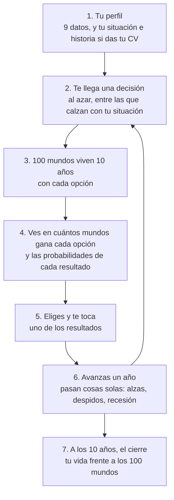

# Cómo funciona Agarra la pala

Lee esto antes de cambiar algo. Cuenta qué vive la persona que juega, qué pasa por dentro y de dónde sale cada número. Al final dice cómo agregar una decisión, un resultado o un dato sin romper el respaldo estadístico.

| Si vas a... | Lee |
|---|---|
| Entender el juego | Esta guía, hasta "Qué hace Claude y qué no" |
| Hablar del juego sin confundir palabras | [GLOSARIO.md](GLOSARIO.md) |
| Cambiar algo que parece raro | [DECISIONES.md](DECISIONES.md): lo que decidimos a propósito y por qué |
| Agregar una decisión, un resultado o un dato | Esta guía, desde "Dónde vive cada cosa" |
| Saber qué es de cada uno | [FRENTES.md](FRENTES.md) |
| Tocar el código | [DEV.md](../DEV.md) y [backend/simulador/README.md](../backend/simulador/README.md) |

## La idea

Tienes una duda de trabajo: ¿me cambio?, ¿pido aumento?, ¿me voy a una startup? Nadie puede decirte cómo va a salir, porque depende de la decisión y también de lo que te pase sin que lo elijas.

El juego no te da una respuesta. Te muestra **100 mundos posibles**. En cada uno vive una copia tuya que prueba **todas las opciones** viviendo lo mismo, y cuentas en cuántos mundos te va mejor con cada una. Después eliges tú, te toca uno de los resultados y vives tu año. Tú eres el mundo 101.

No sirve para maximizar el sueldo. Sirve para ver el abanico de lo que le pasa a gente como tú, y decidir pensando en lo que te importa.

## Una partida, paso a paso



1. **Tu perfil.** Nueve datos: edad, sexo, estudios, carrera, rubro, tipo de empleador, cargo, sueldo y riesgo que toleras. Si das tu LinkedIn o tu CV, Claude también lee tu situación de hoy (si trabajas remoto, a media jornada, con IA, o estás buscando) y tu historia (cada cuántos años te cambias de pega). Siempre los revisas antes de jugar.
2. **El año.** Si la vida te obliga (te despidieron), decides eso. Si no, a veces te llega una propuesta sin buscarla: una oferta, una startup que te llama. Si no te llega nada, es un **año tranquilo**: puedes seguir igual o buscar algo tú (pedir aumento, estudiar, emprender). La decisión dice por qué te tocó: "es obligada", "te llegó" o "la buscaste tú".
3. **Los 100 mundos.** Antes de elegir, el motor juega 100 mundos. En cada uno, tu copia vive 10 años una vez por cada opción.
4. **La comparación.** Cada punto de la nube es un mundo, pintado con la opción que ganó ahí. Tocas un punto y ves qué pasó en ese mundo. Cada opción muestra sus resultados posibles con su probabilidad ("te sube el sueldo: 54 de 100").
5. **Tu resultado.** Eliges y te toca uno de los resultados de esa opción, según su probabilidad.
6. **El año.** Pasan los eventos que nadie decide: alza anual, ascenso, despido, una oferta que llega, una recesión. Al cerrarlo ves cómo cambió tu sueldo, línea por línea, y lo que has ganado en sueldos desde que empezaste.
7. **El cierre.** Tras 10 años comparas tu vida con los 100 mundos.

## Lo que pasa por dentro

### Un mundo es fijo

Todo lo que decide el azar se identifica por mundo, año y sitio (por ejemplo, "mundo 37, año 3, ¿hay recesión?"). Por eso, en un mismo mundo, la recesión cae el mismo año en todas las opciones. Lo de la pega (ascenso, despido, oferta) se comparte mientras las vidas siguen en el mismo trabajo; cuando una se cambia, tiene su propia suerte en la pega nueva. Así, si en ese mundo te va mejor con una opción, es por la decisión o por lo que esa decisión te trajo, no por casualidad. Esto vive en `azar.py` y en `_sitio_evento` de `motor.py`.

### Tu copia decide solo la primera

En cada mundo, la copia toma la opción que se compara y después no recibe más decisiones al azar. Si la vida la obliga a decidir (la despiden, le llega una oferta), responde como responde la gente real: por ejemplo, ante una oferta, 34% se cambia, 9% negocia y 57% se queda. Si tu CV muestra que te cambias seguido, tu copia acepta más ofertas. Esos pesos están en `politicas.py` (`PESOS_FORZADAS`, `PESOS_CARTAS` y `pesos_personales`). Así la comparación mide el efecto de esa decisión, no de diez decisiones encadenadas.

### Sin trabajo, el año pasa mes a mes

Si te despiden, decides cómo enfrentarlo (carta `cesantia`): buscar trabajo, trabajar informal mientras buscas, un bootcamp o emprender. Si buscas (o trabajas informal y sigues postulando), el resto del año se vive de a un mes, desde el mes del despido. Cada mes un dado decide si llega una oferta (evento `oferta_cesante`, con paso `"mes"`); si llega, trae sueldo y empleador, y la aceptas o la rechazas (`oferta_en_cesantia`). Cada mes sin trabajo suma a `meses_cesante` (`mes_buscando`): con los meses te llaman menos y las ofertas pagan menos. Los meses buscando no suman sueldo. No hay recontrato automático: quien vuelve rápido lo hace por una oferta.

Tus copias responden las ofertas con una regla fija (`acepta_oferta_cesante` en `politicas.py`): aceptan si paga al menos 90% de lo que ganaban, o cualquiera desde el séptimo mes. Con esa regla se calibró `K_OFERTA_CESANTE` para que la búsqueda dure lo que mide la EPS. En el motor, los pasos del mes son `("mes", m)` en la cola del año (`_buscar_mes_a_mes`).

Una oferta paga lo que dice: el resultado de la decisión fija cuánto cambia el sueldo, y la empresa y el cargo nuevos no se apilan encima (`_asignar_empresa`). Así la etiqueta ("te sube el sueldo") y `P_SUBE_CAMBIO` siguen siendo ciertas.

### Qué se compara

El sueldo al año 10, el cargo, los meses sin trabajo y el estado (empleado, cesante, independiente). Un mundo lo gana la opción con mayor sueldo final. Si las dos primeras quedan a menos de 0,5%, es empate.

El ánimo y la energía existen en el modelo, pero casi no se mueven con las decisiones de trabajo, así que no se muestran.

### La incertidumbre de la IA

Nadie sabe qué tan rápido va a avanzar la IA, y para eso no hay frecuencias como las de la recesión. El juego lo trata así (`app/sim/motor/ia.py`):

- **Cada mundo trae un ritmo de la IA**: lento, medio o rápido, igual para todas sus vidas. Sale con los pesos que economistas y superforecasters dieron a cada escenario al 2030 (FRI 2026): 42%, 45% y 13%. Es un pronóstico de expertos, y la pantalla lo dice.
- **Tu cargo tiene un tipo**: la IA lo automatiza, lo complementa, no se sabe o no lo toca (OIT 2025, `ia_cargos_ciuo08.csv`).
- **El ritmo mueve la contratación, no los despidos**, como en los datos: donde la IA automatiza, a los menores de 30 les cuesta más encontrar pega, y la brecha crece hasta 2030 (`ia_encontrar`). Solo con IA rápida hay reestructuraciones (`ia_reestructura`), del tamaño que el FRI ve en el desempleo.
- **Eventos y decisiones de IA**: tu empresa adopta IA (y te pregunta si lideras, aprendes, sigues o te vas), se pincha la burbuja de la IA, hay un auge del cobre por los data centers. `aprender_ia` separa el curso corto (no mueve el sueldo, dato SENCE) del programa largo (cobra la prima de saber IA al cambiarte).
- **Lo que ve la persona**: un titular por año según el ritmo de su mundo, y el cierre dice qué ritmo vivió, cuánto habría ganado su opción con cada ritmo y quién pronostica qué.
- **La AGI y la superinteligencia no entran con números**: no hay frecuencias ni consenso. Aparecen como voces en el cierre.

Se prende y se apaga con la variable de entorno `BIFURCA_IA` (`0` la apaga; por omisión está prendida). Apagada, el juego es el de antes. Los tests corren con ella apagada salvo los marcados `@pytest.mark.ia` (`tests/test_motor_ia.py`). Con ella prendida, la cohorte de validación sigue cuadrando y el desempleo juvenil sube entre 1 y 2 puntos, lo que ve el FRI.

## De dónde salen los números

Todo número del juego sale del **paquete de datos** en `backend/simulador/`. El código no tiene probabilidades escritas a mano: las lee del paquete y las ejecuta.

| Archivo | Qué trae |
|---|---|
| `decisiones.json` | Las decisiones (el "banco de preguntas"): cuándo aparecen, cuánto pesan, sus opciones y los resultados de cada una con probabilidad y efecto |
| `eventos.json` | Lo que pasa solo: alza, ascenso, despido, oferta, recesión, cierre de la startup |
| `parametros.json` | Cada número con su unidad, fuente, calidad y rango |
| `fuentes.json` | La cita y el enlace de cada fuente |
| `tablas/*.csv` | Datos en bruto: ESI y ENE del INE, EPS, ELSOC, NY Fed, Y Combinator, Get on Board... |
| `objetivos_validacion.json` | Lo que una población simulada debería reproducir de Chile |

Un ejemplo completo. La decisión "Te llega una oferta" tiene la opción "Cambiarte". Su resultado "El cambio te sube el sueldo" tiene probabilidad `k('P_SUBE_CAMBIO')`. Ese parámetro vale 0,54, viene del Banco Central (IPoM 2018) y su calidad es **dato**.

Cada parámetro tiene una de tres calidades:

- **dato**: medido en Chile o leído en la fuente original.
- **mixto**: dato de otro país, o dato chileno con un ajuste del equipo.
- **supuesto**: sin fuente. Si se muestra al jurado, hay que decirlo.

Para ver el conteo actual y qué falta reemplazar:

```bash
make supuestos                      # todos, ordenados de supuesto a dato
make supuestos CALIDAD=supuesto     # solo los supuestos del equipo
make validar                        # cuántas metas de Chile reproduce una cohorte de 5.000 personas
```

No copies estos conteos a otros documentos: cambian cuando alguien agrega un dato. Mejor cita el comando.

## Qué hace Claude y qué no

Claude se usa en dos lugares:

- **Leer tu texto para llenar el perfil** (`services/perfil_ia.py`). No inventa: lo que tu texto no dice queda vacío y se completa con un valor por defecto marcado como supuesto.
- **Narrar** la ficha de una oferta, los eventos del año y la historia de un mundo con la empresa, el rubro y el cargo concretos (`services/narrador_ia.py`). Parte de la plantilla de `narrativa.py` y no puede escribir números: si escribe uno, o se demora, queda la plantilla tal cual.

Claude **no** calcula probabilidades, no decide qué decisión sale y no escribe resultados. La historia de cada decisión ("te escribe por LinkedIn la jefa de producto de Pagosur") sale de plantillas en `narrativa.py`, sin cifras. Las ofertas nombran empresas reales del catálogo como ejemplo, con el aviso de que sus cifras y lo que les pasa son simulados; un cierre o un despido nunca se cuenta con el nombre de una empresa real (ni en la plantilla ni cuando narra Claude, que lo valida `narrador_ia.py`).

Regla del producto: **los números salen de los datos; la IA hace todo lo demás.** Puede personalizar cómo se cuenta una decisión, preguntarte lo que te importa o buscar fuentes nuevas, pero no poner una probabilidad ni un efecto.

## Dónde vive cada cosa

| Quiero cambiar... | Archivo |
|---|---|
| Una decisión, sus opciones o sus resultados | `backend/simulador/decisiones.json` |
| Algo que pasa solo (despido, recesión) | `backend/simulador/eventos.json` |
| Un número y su fuente | `backend/simulador/parametros.json` y `fuentes.json` |
| Cómo responde la población a una decisión | `backend/app/sim/motor/politicas.py` |
| Qué eventos quedan fuera del juego (solo trabajo: hoy, el cáncer) | `EVENTOS_PERSONALES` en `motor.py` |
| Del perfil a las variables de la copia | `backend/app/sim/motor/perfil.py` |
| La incertidumbre de la IA y su flag | `backend/app/sim/motor/ia.py`, `backend/simulador/escenarios_ia.json` y `backend/scripts/ia_oit.py` |
| Leer el perfil desde un texto o con tu Claude | `services/perfil_ia.py` y `services/perfil_doc.py` |
| La historia que cuenta cada decisión | `backend/app/sim/motor/narrativa.py` |
| Empresas reales de ejemplo | `backend/data/empresas/` y `empresas.py` |
| Los 100 mundos y el ganador de cada uno | `backend/app/sim/motor/gemelos.py` |
| La partida de la persona | `backend/app/sim/motor/partida.py` |
| Pantallas | `frontend/src/features/juego/` |
| El tutorial | `frontend/src/features/juego/components/ComoFunciona.tsx` |

## Cómo agregar cosas

### Una decisión nueva (una pregunta más en el banco)

Sí se puede. La decisión en sí no sale de un estudio: la escribimos nosotros. Lo que tiene que tener respaldo son sus números.

1. Agrégala a `decisiones.json` con su `cuando` (a quién le aparece), su `aparicion.peso` (qué tan seguido), sus opciones y los resultados de cada opción con `prob` y `efectos`.
2. Cada probabilidad y cada efecto apunta a un parámetro de `parametros.json` con su fuente. Si no hay fuente, el parámetro va con `"calidad": "supuesto"` y `"fuente": "equipo"`. No escribas números sueltos dentro de la decisión.
3. Agrega en `politicas.py` cómo responde la población (`PESOS_CARTAS`). Sin eso, en los mundos donde aparece más adelante, la copia siempre elige no hacer nada.
4. Corre `python3 -I backend/simulador/referencia/validar.py 4000` y `make test`.

Una decisión que se basa solo en supuestos funciona, pero debilita el pitch. Si el dato no existe, dilo en el texto de la decisión.

### Un resultado nuevo de una opción

Es un elemento más en `resultados`, con su `prob`, `texto`, `tono` y `efectos`. Las probabilidades de una opción suman 1; usa `"prob": "resto"` en la última.

### Una medida final nueva (lo que llamamos "outcome": satisfacción, tiempo libre)

Es más trabajo, porque toca las tres capas:

1. La variable tiene que existir en `estado.json` y moverse por efectos con fuente.
2. `gemelos.py` tiene que resumirla en cada mundo.
3. El frente tiene que mostrarla.

Antes de agregarla, revisa si de verdad cambia entre opciones: el ánimo y la energía ya existen y no se muestran porque casi no se mueven.

### Un dato nuevo del perfil

1. Súmalo a `Perfil` en `perfil.py` y dile a qué variable de la copia corresponde.
2. Agrégalo al prompt y al lector de `perfil_doc.py`, y al esquema de `perfil_ia.py`.
3. Muéstralo en `PerfilForm.tsx`.

Si ninguna regla del paquete lo usa, el dato no cambia la simulación: solo sirve para personalizar texto.

## Antes del PR

Lo de siempre, en [AGENTS.md](../AGENTS.md): rama propia, `make test` y `cd frontend && npm run build`. Si tocaste el paquete, corre también el validador.
