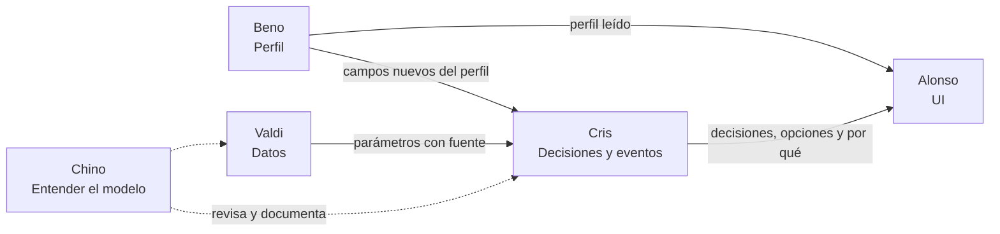

# Frentes de trabajo

Borrador para los tickets del proyecto. Cada frente dice qué busca, qué archivos son suyos, con quién conversa y cuándo está listo. La idea es que nadie se pise: si necesitas cambiar un archivo de otro frente, avísale o pídeselo.

Antes de partir, todos leen [COMO-FUNCIONA.md](COMO-FUNCIONA.md). La regla que no se rompe: **los números salen de los datos; la IA hace todo lo demás.** Ninguna probabilidad sale de un LLM.

## Mapa

| Archivo | Dueño |
|---|---|
| `backend/simulador/decisiones.json`, `eventos.json` | Cris |
| `backend/simulador/parametros.json`, `fuentes.json`, `tablas/`, `backend/data/empresas/` | Valdi |
| `motor/politicas.py`, `motor/narrativa.py` | Cris |
| `motor/perfil.py`, `services/perfil_ia.py`, `services/perfil_doc.py` | Beno |
| `frontend/src/features/juego/` | Alonso (Beno toca solo `PerfilForm.tsx`) |
| `docs/` | Chino |
| `motor/motor.py`, `gemelos.py`, `partida.py` | Nadie por defecto: si hay que tocarlos, se conversa antes |

Si tu cambio necesita un campo nuevo en la API, súmalo a `frontend/src/features/juego/types.ts` en el mismo PR y avísale a Alonso.

---

## Cris: decisiones y eventos

**Objetivo.** Que las decisiones que salen tengan sentido para la persona y aporten algo que no sabía.

**Tareas.**
1. **Filtrar decisiones que no calzan.** Ya empezó en el PR #14: remoto, media jornada, usa IA y cesantía vienen del CV. Si ya trabajas remoto, no te sale "pedir híbrido"; si estás en una empresa grande, no te sale "unirte a una más grande". Se hace con el `cuando` de cada decisión en `decisiones.json`, usando las variables del perfil. Si falta una variable (por ejemplo, `remoto`), se la pides a Beno.
2. **Eventos del mundo que anticipan lo que viene** (spec "insightful", abajo), junto con Valdi.
3. **Toda decisión nueva trae sus números con fuente**, o marcados como supuesto, y su peso de población en `politicas.py`.

**Listo cuando.** El validador del paquete pasa, `make test` pasa y `make supuestos` no suma supuestos sin decirlo en el PR.

## Alonso: UI, animaciones y menos texto

**Objetivo.** Que se entienda el juego sin leer, que sea entretenido y que dé ganas de jugar otra vez.

**Tareas.**
1. **Que quede claro el juego.** En los primeros 10 segundos, quien juega tiene que entender tres cosas: me llega una decisión, veo cómo les fue a 50 copias mías, elijo y me toca uno de los resultados. Probar con alguien que no conoce el juego y anotar dónde se pierde.
2. **Que sea entretenido.** Animaciones en los momentos que importan: llega la decisión, corren los mundos, te toca tu resultado, cambia el año. El tono es de juego, no de informe.
3. **Cortar texto.** Cada pantalla con una sola idea. Frases cortas; lo que sobra va a un "ver más". Meta: la decisión se entiende sin bajar en el celular.

**No cambia.** Los números ni lo que significan: si un texto dice "27 de 50", ese número viene del motor.

**Listo cuando.** Alguien nuevo juega una partida completa sin preguntar nada, y `npm run build` compila.

## Valdi: enriquecer datos

**Objetivo.** Más números con fuente y menos supuestos, sobre todo en lo que el jurado va a preguntar.

**Tareas.**
1. **Empresas y sueldos por empresa.** Ampliar `backend/data/empresas/` y las tablas de sueldo. Las empresas reales siguen siendo ejemplo: la simulación usa rubro, tamaño y tipo de empleador, no la empresa.
2. **Aceleración de la IA.** Ya existe `tablas/ia_aplicabilidad_ocupaciones.csv` (Microsoft). Definir con Cris cómo entra como evento del mundo.
3. **Incertidumbre.** Usar el `rango` de cada parámetro para mostrar qué tan seguro es un número.
4. **Reemplazar supuestos.** Partir por los que más mueven el resultado (`make supuestos CALIDAD=supuesto`).
5. **Sonnet para buscar y leer fuentes**, no para inventar cifras. Cada número que entra trae cita y enlace en `fuentes.json`.

**Listo cuando.** `make validar` no empeora y cada parámetro nuevo tiene fuente y calidad.

## Beno: mejorar el perfil

**Objetivo.** Que llenar el perfil sea rápido y que lo leído sea correcto.

**Tareas.**
1. **LinkedIn y currículum.** Leer bien el PDF de LinkedIn o un currículum pegado: cargo, rubro, tamaño de empresa, años de experiencia, historial de empresas.
2. **Campos nuevos que sirvan para filtrar decisiones** (remoto, años en el rubro, historial). Coordinar con Cris cuáles usa el paquete. Un campo que ninguna regla usa no cambia la simulación: solo sirve para personalizar texto.
3. **Mostrar qué se dedujo y qué se supuso**, para que la persona corrija.
4. **Un perfil en dos capas.** "Quién eres" (datos, personalidad, lo que te importa) separado de "qué hiciste" (tu historial en el juego). Un test de personalidad o de valores sirve ya para personalizar cómo se cuenta cada decisión. Para cambiar probabilidades necesita un estudio que lo respalde.

**Listo cuando.** Tres currículums reales distintos se leen sin errores en los 9 campos.

## Chino: entender el modelo, las decisiones y los datos

**Objetivo.** Que el equipo y el jurado puedan responder "¿de dónde sale este número?".

**Tareas.**
1. Leer `COMO-FUNCIONA.md` contra el código y corregir lo que no calce.
2. Lista de las 5 o 6 cifras más fuertes para el pitch, con su cita (de `fuentes.json` y `make supuestos`).
3. Lista honesta de lo que es supuesto y si importa.
4. Revisar los PRs que tocan `backend/simulador/` para que no entren números sin fuente.

**Listo cuando.** Cualquiera del equipo puede contestar de dónde sale un número mirando la guía.

---

## Specs de lo "wow"

### 1. Decisiones que saben de ti (personalización)

**Qué ve quien juega.** Siempre has trabajado en bancos y te llega una oferta: la decisión dice "Banco Andino, más grande que el tuyo, te ofrece entrar". Si trabajas remoto, nunca te pregunta si quieres pedir días remotos.

**Cómo funciona.** Hay dos partes:

- **Qué decisión sale** (Cris): con el `cuando` del paquete y los campos del perfil. Es determinista y no usa LLM.
- **Cómo se cuenta** (Cris, con datos de Beno): hoy la historia sale de plantillas en `narrativa.py`. Se puede pasar el perfil y el historial de la partida a Claude para que reescriba la historia. Claude solo cambia el texto: las opciones, las probabilidades y los efectos siguen siendo los del paquete. Si Claude falla, queda la plantilla.

**Pregunta abierta.** ¿Que salgan más seguido las decisiones que te interesan? Cambia la probabilidad de cada una, que hoy sale de lo que le pasa a la población. Mejor dejarlo para después.

### 2. Hechos que anticipan lo que viene (insightful)

**Qué ve quien juega.** "Año 3: la IA avanzó fuerte en tu ocupación." Y la decisión siguiente: "¿Sigues en software o te cambias?", con el efecto en sueldo y en riesgo de despido según qué tan expuesta está tu ocupación.

**Cómo funciona.** Un evento del mundo nuevo en `eventos.json` (como `recesion`), que cae igual en todas las opciones de un mismo mundo. Su efecto depende de `ia_aplicabilidad_ocupaciones.csv` y puede encadenar con `luego` una decisión que ya existe (`aprender_ia`, `cambiar_de_ocupacion`). Cris arma el evento y Valdi la probabilidad y el efecto, con fuente.

### 3. Que la persona escriba su propia decisión

Mejor no todavía. Una decisión nueva necesita probabilidades con respaldo, y un LLM no puede inventarlas. Hoy la persona puede elegir su primera duda de una lista de decisiones del paquete. Un paso intermedio posible: que escriba su duda con sus palabras y Claude elija la decisión más parecida, sin tocar sus números.
